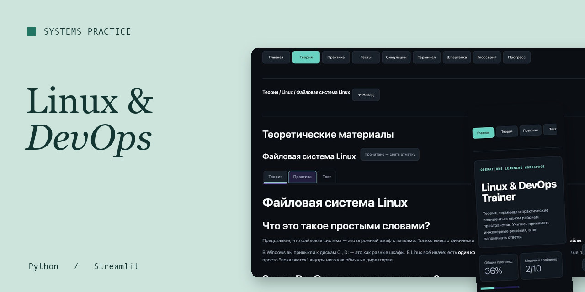
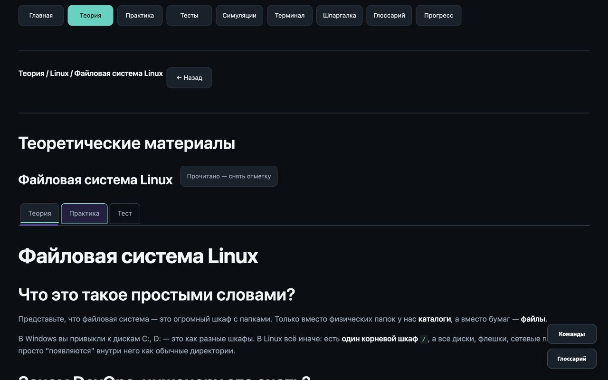
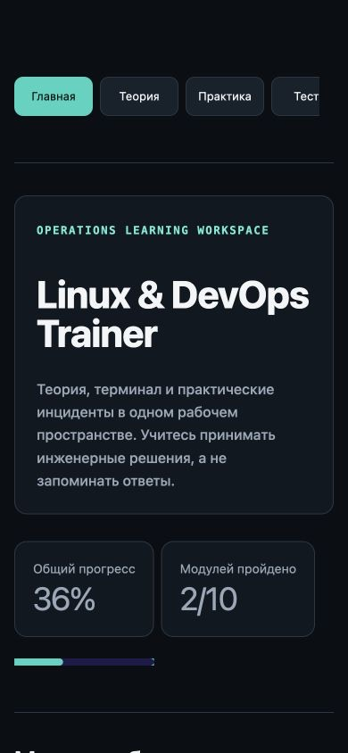

**RU** · [EN](README_EN.md)　 /　 [Профиль](https://github.com/mrjakeball) · [Каталог проектов](https://github.com/mrjakeball/portfolio)

# Linux & DevOps Trainer

Тренажёр для изучения Linux и основ DevOps. Тему о файловой системе можно прочитать, разобрать команды и перейти к лабораторной или тесту.

Проверен локально · Публичная витрина приватного проекта  
Python · Streamlit

## Как устроен учебный терминал

Ввод обрабатывает симулятор с набором учебных сценариев. Команды меняют состояние упражнения, а системная оболочка пользователя в этом процессе не участвует. HTML экранируется перед выводом результата.

Логика упражнений отделена от интерфейса Streamlit. Теория, глоссарий, тесты и практические сценарии доступны из одной навигации. На мобильном снимке показан прогресс демонстрационного профиля.

## Исходные изображения

[Тема о файловой системе](assets/screen-topic-desktop.jpg) · [Демонстрационный профиль](assets/screen-home-mobile.jpg)

Развернуть галерею

[Примечание о проекте](NOTICE.md) · [Профиль](https://github.com/mrjakeball) · [Каталог проектов](https://github.com/mrjakeball/portfolio)
