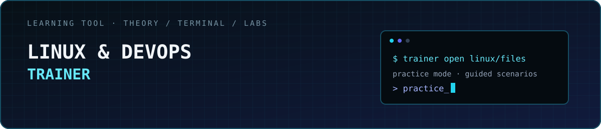
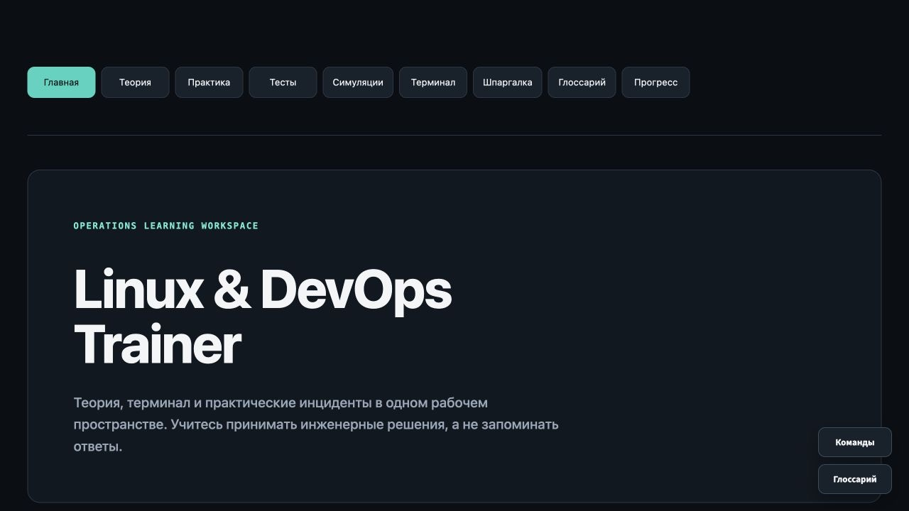
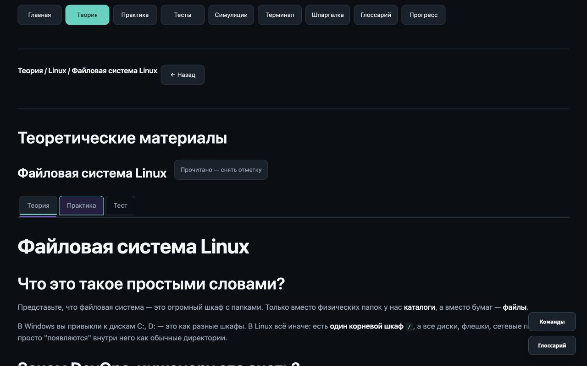
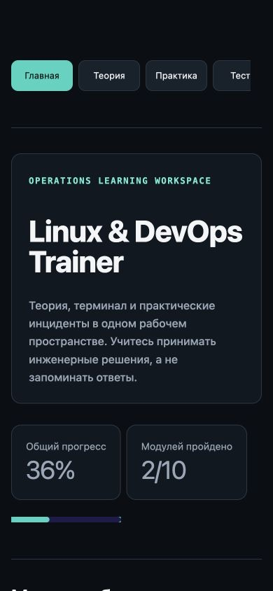

  

  <a href="./README.md">Русский</a> · <strong>English</strong> · <a href="https://github.com/mrjakeball/portfolio">All projects</a>

# Linux & DevOps Trainer

An interview preparation trainer for Linux and DevOps fundamentals, combining theory with a terminal, tests and practical engineering situations.

| Mode | Details |
|---|---|
| Purpose | Independent practice and topic revision |
| State | Verified locally |
| Technology | `Python` `Streamlit` `Linux` `Testing` |
| Publication | Showcase; source code is not included |

  
  

  

The mobile image shows a demonstration profile's progress, not an assessment of the author's skills.

## Preparation format

Each topic combines a short explanation, commands and a task. The learner moves through a scenario and checks their understanding instead of only reading an answer.

## Learning modes

- topics covering Linux and core DevOps practices;
- practical labs and tests;
- a glossary for quick revision;
- simulations of engineering situations.

## Terminal safety

The terminal is implemented as a learning simulation: input is parsed inside the application and displayed output is HTML-escaped. Exercise logic is kept separate from the interface and covered by checks.

  <a href="https://github.com/mrjakeball/portfolio">← Back to all projects</a>

